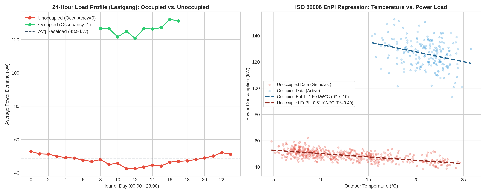

# ISO 50001 & ISO 50006 Energy Baseline (EnB) & Load Profile Analysis

A Python-based data pipeline designed to automate initial energy reviews (*Energetische Bewertung*) in accordance with **ISO 50001** and establish weather-normalized Energy Performance Indicators (**EnPI**) under **ISO 50006**.

### Key Capabilities / Funktionen
* **Load Profile & Baseload Detection (Lastgang- & Grundlastanalyse):** Separates 15-minute smart meter intervals into Occupied vs. Unoccupied operational states to isolate phantom loads and peak demand (*Lastspitze*).
* **Weather-Normalized Regression (ISO 50006):** Models energy sensitivity against ambient temperature ($\text{kW}/^\circ\text{C}$) with domain-bounded trendlines.
* **Business Case Quantification:** Automatically calculates annual kWh, cost (€), and $\text{CO}_2$ savings potential from targeted baseload reductions.

### Tech Stack
* **Language:** Python 3
* **Libraries:** `pandas`, `numpy`, `matplotlib`, `seaborn`, `scikit-learn`
